<div align="center">

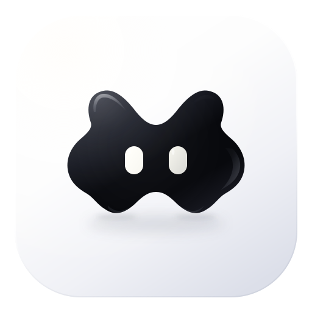

# Woods Island

**Dynamic Island для Windows · Woods Personal Corp**

[](https://github.com/nimalekyt-bit/woods-island/releases)
[](https://github.com/nimalekyt-bit/woods-island/releases/tag/v1.0.0)


[**Скачать сборку**](https://github.com/nimalekyt-bit/woods-island/releases/tag/v1.0.0) · [**Сообщить об ошибке**](https://github.com/nimalekyt-bit/woods-island/issues/new/choose) · [**Woods**](https://t.me/woodskilla)

</div>

<details open>
<summary><b>Русский</b></summary>
<br>

Чёрная жидкая пилюля у верхнего края экрана. Показывает музыку и события,
а по клику раскрывает инструменты, которыми пользуешься каждый день.

<div align="center">

</div>

## Пилюля живая

Музыка, обложка и прогресс трека. Часы, таймер, микрофон, запись экрана,
загрузки и работа ИИ-агентов. Край острова реагирует на реальный звук через
WASAPI: низкие и высокие частоты, цвет обложки и движение жидкости.

GSMTC подключает обычные Windows-плееры. Яндекс Музыка Mod работает через
Woods-коннектор даже когда клиент не публикует медиасессию Windows.
Остров раскрывается по клику. Размер меняется от **80 до 200%**;
автоскрытие возвращает пилюлю от верхнего края. Область вокруг острова
пропускает клики к окнам под ним.

## 25 персонажей

Жидкий остров, Пиксель, Искра, Глазки, медуза, костёр, хомяк и другие.
Выбирай в **Настройки → Персонаж**. Все доступны без покупки ключа;
реагируют на музыку, курсор и события.

<div align="center">
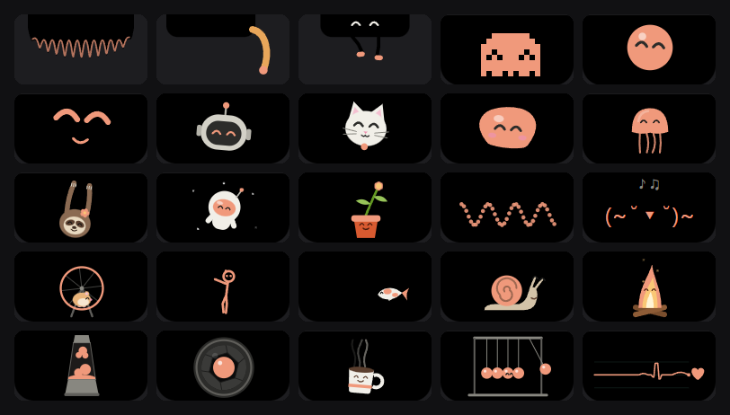
</div>

## Погода

Сейчас, следующие 24 часа и прогноз до семи дней. Ветер, влажность,
давление, осадки и восход/закат. Город выбираешь сам;
MET Norway не требует ключа. Старый кэш и некорректный ответ больше
не обрушивают панель. Отсутствующие данные показываются как недоступные.

<div align="center">
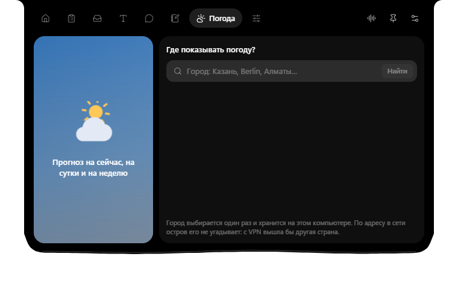
</div>

На снимке — пустое состояние до выбора города.
После выбора города прогноз запрашивается по его координатам.

## Что внутри

<table>
<tr>
<td width="50%" valign="top">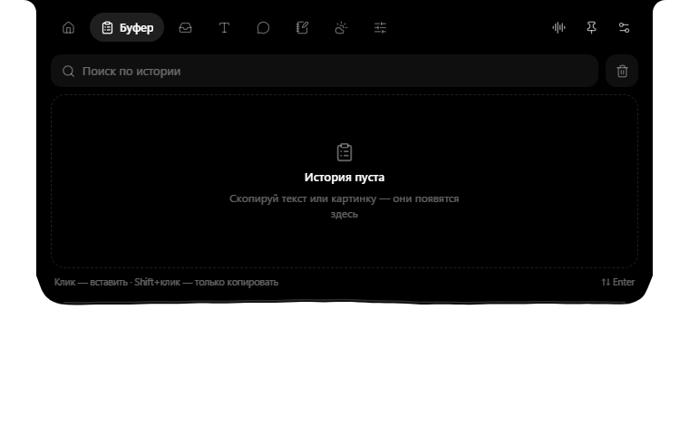<br><b>Буфер.</b> История текста, изображений и файлов, поиск и закрепление. Локальное хранение в SQLite.</td>
<td width="50%" valign="top">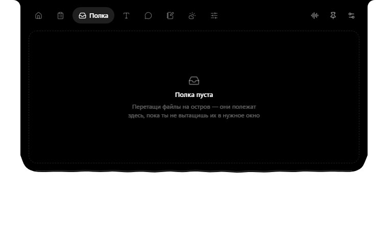<br><b>Полка.</b> Перетащи файлы на остров и забери, когда понадобятся. Содержимое переживает перезапуск.</td>
</tr>
<tr>
<td valign="top">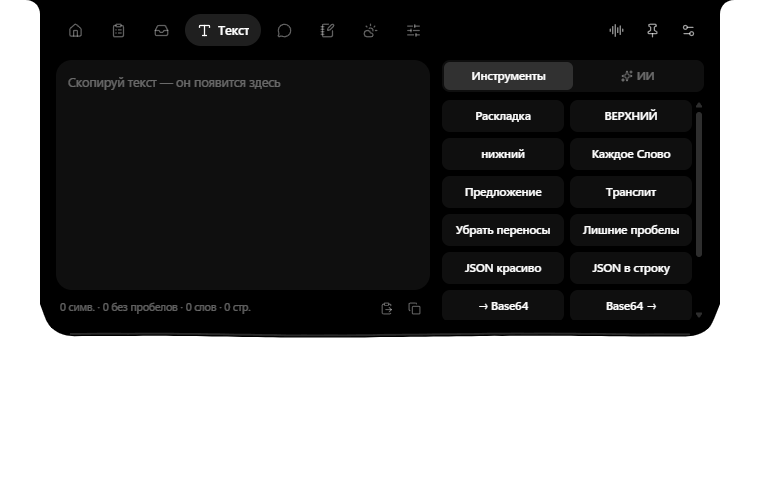<br><b>Текст.</b> Раскладка, регистр, транслитерация, JSON, Base64, URL, QR и действия ИИ.</td>
<td valign="top">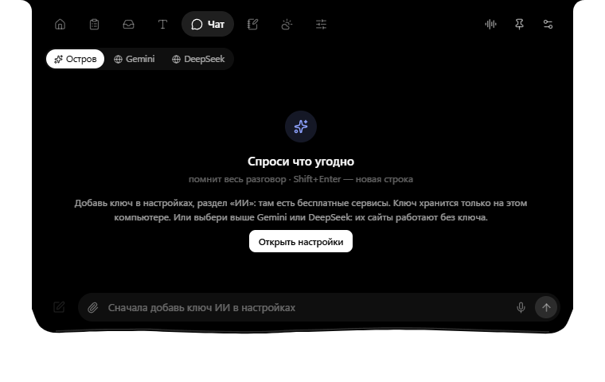<br><b>ИИ.</b> Документы, изображения и потоковые ответы. Свой API-ключ или локальная модель.</td>
</tr>
<tr>
<td valign="top"><br><b>Заметки и Obsidian.</b> Форматирование, папки, таймер и напоминания. Кнопка «В Obsidian» сохраняет Markdown в выбранный vault без перезаписи файлов.</td>
<td valign="top">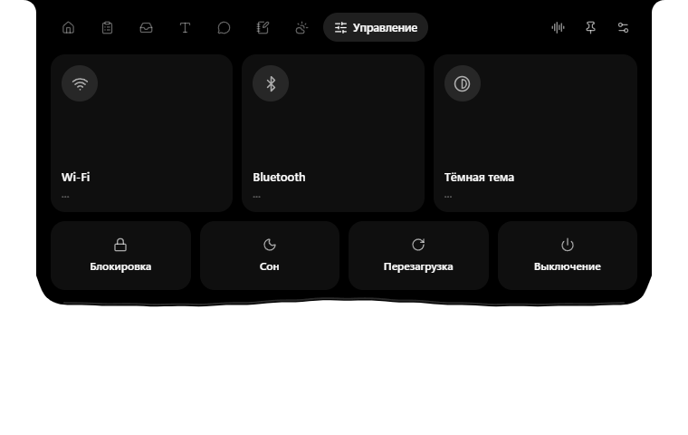<br><b>Управление.</b> Звук, микрофон, сеть, тема Windows и системные действия. Выбор устройств виртуального микшера сохраняет системные устройства по умолчанию.</td>
</tr>
</table>

Снимки сделаны в пустом профиле: без города, музыки, устройств, файлов и истории.

### Рабочие инструменты

- Скриншоты области и экрана, редактор с разметкой.
- Windows OCR, распознавание QR и пипетка.
- MP4/GIF и системный звук через WASAPI/FFmpeg.
- Командная строка, поиск, калькулятор, ярлыки и группы лаунчера.
- Диктовка с выбранным микрофоном и своим сервисом распознавания.
- Статусы OBS, Steam и агентов Claude Code / Codex / OpenCode.
- Тема, прозрачность, монитор, масштаб, автоскрытие и горячие клавиши.

### Всё доступно без подписки Woods Island

Персонажи, погода, OCR, запись и ИИ открыты без активации Woods Island.
Оплата внешнего ИИ зависит от твоего провайдера. Встроенных и общих ключей нет.

## Установка

Скачай **Woods-Island-1.0.0-windows-x64.zip** из
[приватного релиза](https://github.com/nimalekyt-bit/woods-island/releases/tag/v1.0.0),
распакуй и запусти `woods-island.exe`. Папка `bin` нужна рядом с EXE
для MP4/GIF. Требуются **Windows 10/11 x64** и WebView2 Runtime.
Скачивание требует доступа к репозиторию. Переносимый комплект обновляется вручную.

В **Настройки → ИИ** укажи свой ключ/адрес или локальную модель;
в настройках заметок — путь к Obsidian. На другом ПК для Яндекс Музыки Mod
потребуется отдельный Woods injector.

### Горячие клавиши

Все сочетания меняются в настройках.

| Действие | Сочетание |
|---|---|
| Открыть / закрыть остров | `Ctrl+Alt+I` |
| Командная строка | `Alt+Space` |
| Чат с ИИ | `Ctrl+Alt+A` |
| Буфер обмена | `Ctrl+Alt+V` |
| Скриншот области / экрана | `Ctrl+Alt+S` / `Ctrl+Alt+Shift+S` |
| Текст с экрана | `Ctrl+Alt+O` |
| Запись экрана | `Ctrl+Alt+R` |

### Приватность и ограничения

Настройки, SQLite и заметки находятся в `%APPDATA%\woods-island`.
Ключи защищает Windows DPAPI. Сетевые источники описаны в
[аудите](docs/RECOVERY_AUDIT.md). Экспорт в Obsidian запускается кнопкой.
Яндекс bridge слушает только `127.0.0.1:3003`; порт меняется через
`WOODS_ISLAND_MUSIC_PORT`. Connector v3 не умеет перемотку;
отдельный OBS Scrobbler может занять тот же порт.
Неизвестные города используют UTC или ручной часовой пояс.
Подписанного автоматического установщика пока нет.

**Проверено 12.11.2026:** 50 Rust-тестов, 3 hook-теста и 35 нативных сценария,
0 ошибок frontend; 1 проверка живой Яндекс Музыки пропущена в изолированном
прогоне. Живой коннектор подтверждён предыдущим отчётом; синхронизация текста
проверена через отдельный музыкальный мост.
Полный аппаратный и облачный паритет не заявляется.
[Матрица приёмки →](docs/FUNCTIONAL_ACCEPTANCE.md)

</details>

<details>
<summary><b>English</b> · click to read</summary>
<br>

A liquid black pill at the top of your screen. Music and events stay visible;
a click opens the player, clipboard, files, notes, weather and screen tools.

<div align="center">
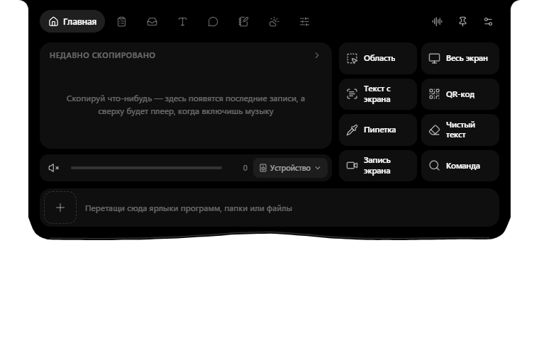
</div>

## A living island

The liquid edge responds to real WASAPI audio and the album colour.
Windows players use GSMTC; Yandex Music Mod uses the Woods loopback connector.
The pill shows artwork and advancing playback time. Resize it from **80 to 200%**,
enable auto-hide and choose from **25 characters**, all available without activation.

<div align="center">

</div>

## Weather

Current conditions, 24 hours and up to seven days from MET Norway.
Choose your city; no weather API key is required. Old caches and invalid data
are rejected without crashing the panel. Missing data is marked unavailable.

<div align="center">

</div>

This screenshot shows the empty state before a city is selected.

## Inside

<table>
<tr>
<td width="50%" valign="top">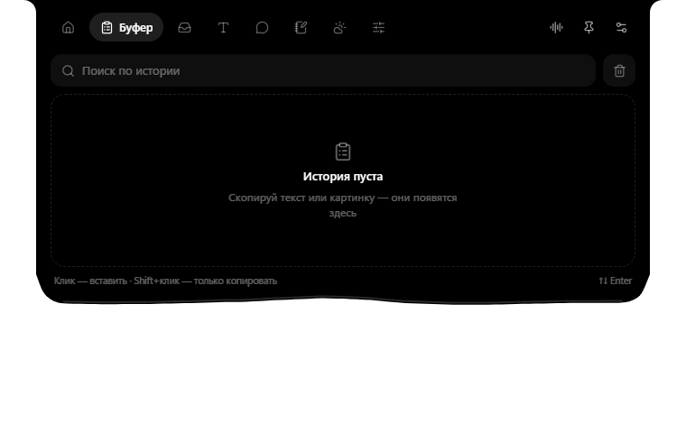<br><b>Clipboard.</b> Local history of text, images and files, search and pins.</td>
<td width="50%" valign="top">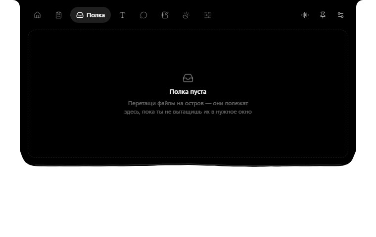<br><b>Shelf.</b> Keep files nearby and retain them across restarts.</td>
</tr>
<tr>
<td valign="top">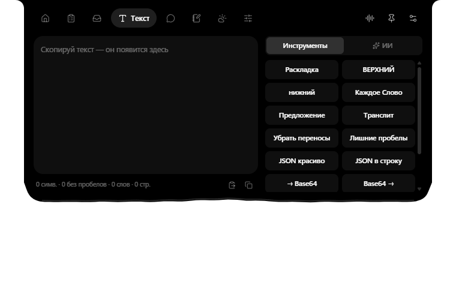<br><b>Text.</b> Layout, case, transliteration, JSON, Base64, URLs, QR and AI actions.</td>
<td valign="top">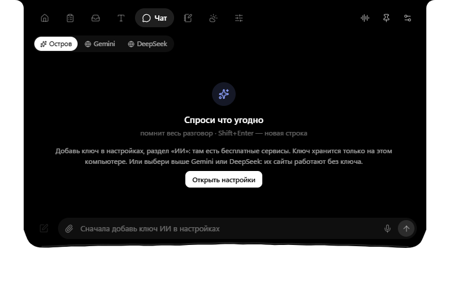<br><b>AI.</b> Streaming chat with images and documents; your key or local model.</td>
</tr>
<tr>
<td valign="top">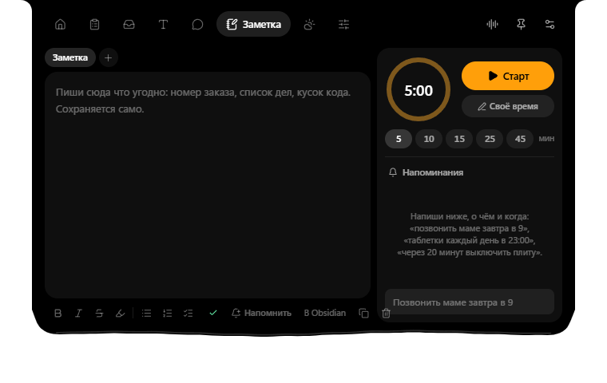<br><b>Notes.</b> Formatting, folders, timers and explicit Markdown export to Obsidian.</td>
<td valign="top">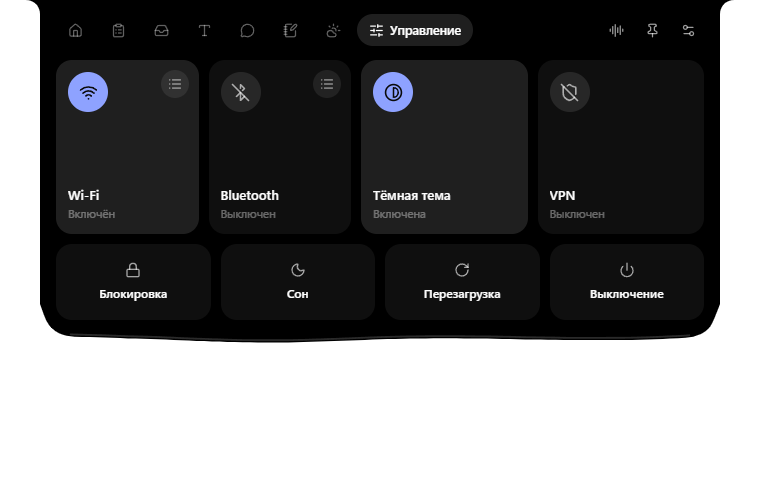<br><b>Controls.</b> Audio, microphone, network, Windows theme and system actions.</td>
</tr>
</table>

Screenshots show empty states without location, music, devices, files or history.
Screen tools include PNG capture and markup,
Windows OCR, QR, a colour picker and MP4/GIF with FFmpeg/WASAPI audio.
The launcher, command bar, dictation and OBS/Steam/terminal-agent events are available.

## Install

Download **Woods-Island-1.0.0-windows-x64.zip** from the
[private release](https://github.com/nimalekyt-bit/woods-island/releases/tag/v1.0.0).
Extract and run `woods-island.exe`; keep `bin` alongside it for recording.
Requires **Windows 10/11 x64** and WebView2. Repository access is required;
updates are installed manually. Use your own AI key or local model.

Settings/SQLite stay in `%APPDATA%\woods-island`, keys use Windows DPAPI,
and Obsidian export is explicit. The Yandex connector needs separate installation
on other PCs and v3 has no seek support. Unknown cities use UTC or a manual offset.

**Verified 12 November 2026:** 50 Rust tests, 3 hook tests, 35 native scenarios,
zero frontend exceptions; one live Yandex Music check was skipped in the isolated
run. Live playback was verified earlier; lyrics timing uses a separate bridge fixture.
Every cloud provider and
hardware action has not been verified. [Acceptance matrix →](docs/FUNCTIONAL_ACCEPTANCE.md)

</details>

## Разработка

Windows, Node.js 22, pnpm 10.33.0, Rust 1.98.1 и Visual Studio Build Tools
с Desktop development with C++.

```powershell
pnpm install --frozen-lockfile
pnpm build
pnpm test:hooks
cargo test --locked --manifest-path src-tauri/Cargo.toml
cargo build --release --locked --manifest-path src-tauri/Cargo.toml
powershell -NoProfile -File scripts/prepare-recording-tools.ps1
pnpm package:portable
```

Runtime: `frontend`, четыре окна, 20 ресурсов, 153 IPC.
Прототип в `src` собирается отдельно через `build:prototype`.
`pnpm test:native` использует временный профиль и `WOODS_ISLAND_PASSIVE_QA=1`,
без аппаратного ввода, фокуса и хоткеев. Нет живого плеера — SKIP.
При заполненном Cargo-кэше доступна сборка `--offline`.

[CI](https://github.com/nimalekyt-bit/woods-island/actions) проверяет сборку,
Rust/hooks и авторство. Коммиты — только от
[nimalekyt-bit](https://github.com/nimalekyt-bit).
Задачи ведутся в `<WORKSPACE>` и Obsidian.

## Проект и сайт

Владелец: Никита Кузнецов / Woods. Исходники и сборки пока приватные.
Условия использования компонентов: [LICENSE](LICENSE) и
[THIRD_PARTY_NOTICES](THIRD_PARTY_NOTICES.md).

Сайт находится отдельно в `02_WEB_&_COMMERCE/woods-island-web`.
Сборка проверена; deployment и анонимное скачивание не подтверждены.
[Состояние сайта →](docs/WEBSITE.md)

<div align="center">
<br>
<b>Woods Personal Corp</b><br>
Никита Кузнецов · <a href="https://t.me/woodskilla">@woodskilla</a> · <a href="https://github.com/nimalekyt-bit">GitHub</a>
</div>
