<div align="center">

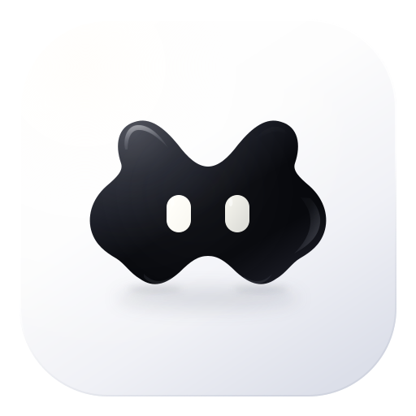

# Woods Island

**Dynamic Island для Windows · 100% бесплатно · Woods Personal Corp**

[](https://github.com/nimalekyt-bit/woods-island/releases)
[](https://github.com/nimalekyt-bit/woods-island/releases/tag/v1.4.2)


[**Скачать установщик 1.4.2**](https://github.com/nimalekyt-bit/woods-island/releases/tag/v1.4.2) · [**Что нового**](RELEASE_NOTES_1.4.2.md) · [**Сообщить об ошибке**](https://github.com/nimalekyt-bit/woods-island/issues/new/choose) · [**Telegram**](https://t.me/woodskilla)

[**Сайт Woods Island**](https://island.woodslab.top/) · [**Портфолио автора**](https://me.woodslab.top/) · [**Woods Lab**](https://woodslab.top/) · [**support@woodslab.top**](mailto:support@woodslab.top)

</div>

---

<details open>
<summary><b>Русский</b></summary>
<br>

<div align="center">

Жидкая чёрная пилюля у верхнего края экрана, которая показывает всё важное прямо сейчас<br>
и по клику раскрывается в набор рабочих инструментов. Полностью бесплатно.

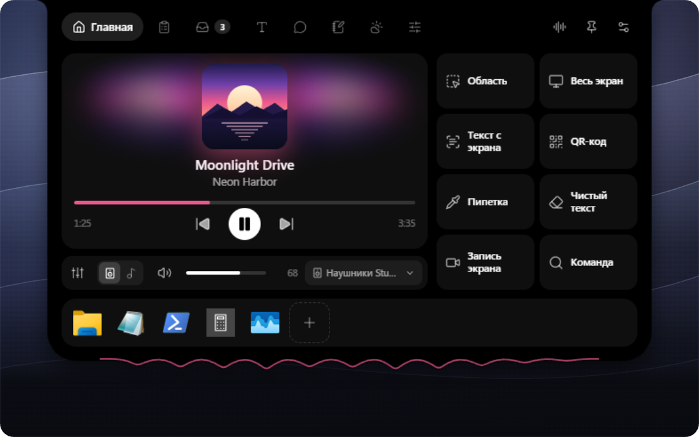

</div>

## Что это

Woods Island живёт поверх всех окон, посередине верхнего края. Свёрнутый — это компактная пилюля с музыкой,
погодой, таймером, нагрузкой ПК, микрофоном, загрузками и уведомлениями. Нажми на неё (или подведи курсор
к верхнему краю) — и она плавно раскроется в панель: буфер обмена, полка с передачей с телефона по QR,
инструменты текста, чат с ИИ, заметки, погода, центр управления и командная строка.

Остров не забирает фокус клавиатуры у окна, в котором ты работаешь — клик по записи буфера вставляет её
прямо туда, где стоял курсор.

<div align="center">
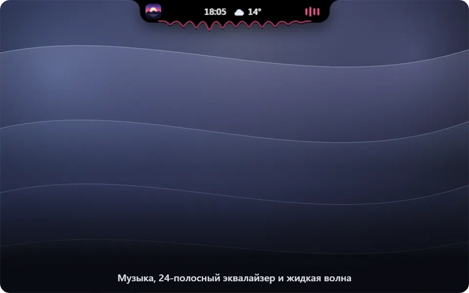
</div>

## Пилюля живая

Сам остров — из ферромагнитной жидкости. Его нижний край тянется к курсору, пульсирует 24-полосным
эквалайзером в цвет обложки трека (через WASAPI Loopback, включая захват только активного плеера) и мягко
успокаивается в тишине.

<div align="center">
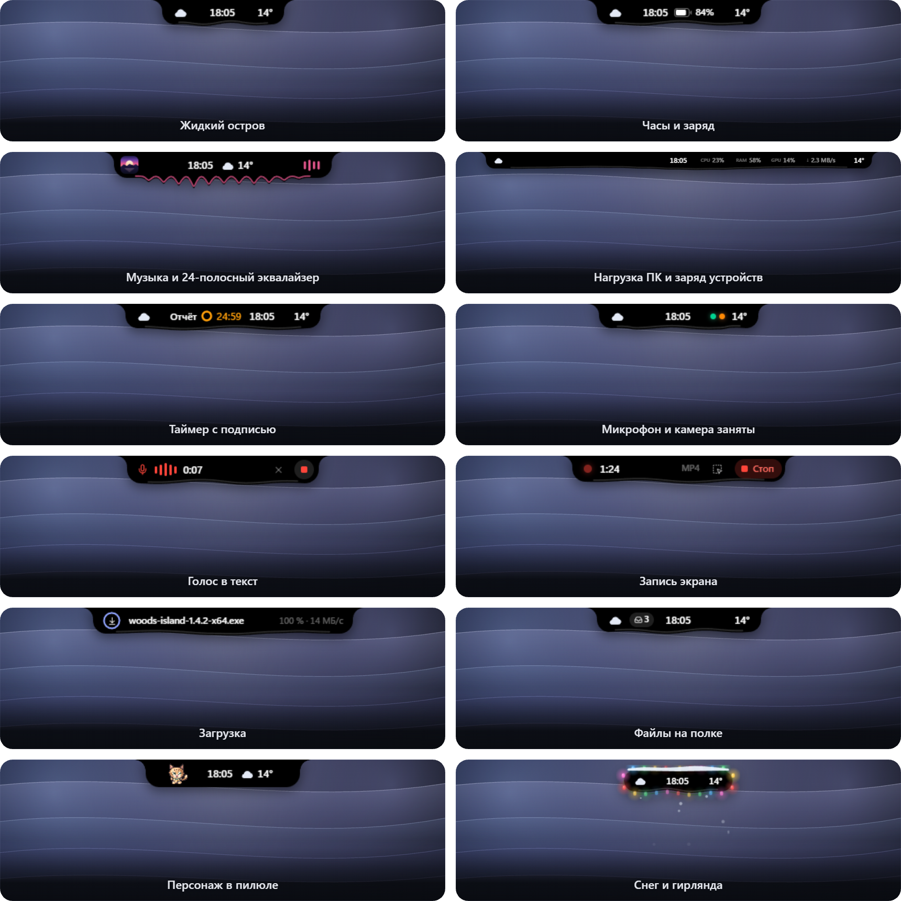
</div>

События аккуратно появляются сами и сворачиваются обратно через пару секунд:

<div align="center">
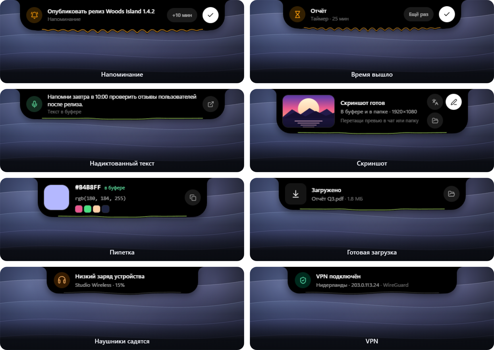
</div>

Музыка с 24-полосным эквалайзером и синхронизированным текстом песен · голосовой ввод · напоминания и таймеры с
подписями · загрузки браузеров, торрентов и Steam · точки микрофона и камеры с быстрым мьютом · громкость
колёсиком мыши · раскладка и Caps Lock · заряд наушников и мышей (включая DAREU A950 Air V3 и ручной замер
Logitech G435) · нагрузка CPU/GPU/RAM/сети · уведомления Windows · VPN со страной и IP · запись экрана и OBS ·
статусы ИИ-агентов (Claude Code, Codex, OpenCode).

Если пилюля мешает вкладкам браузера, есть три решения: **автоскрытие** (выезжает при наведении к верхнему краю
или по хоткею), **список программ** (прячется в полноэкранных играх и выбранных окнах) и **режим выреза
(Notch Bar)** как на MacBook — развёрнутые окна начинаются аккуратно под островом.

<div align="center">
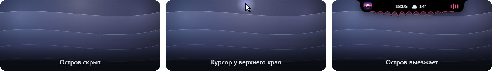
</div>

## 41 встроенный персонаж + 9 питомцев Codex

Жидкий остров включён по умолчанию. Если хочется компании — в **Настройки → Персонаж** ждёт **41 встроенный
персонаж** с живым предпросмотром: Пиксель, Хвост, Остров на ножках, Медуза, Костёр, Хомяк, 5 сезонных
персонажей (Снеговик, Дед Мороз, Снегирь, Пряник, Олень) и **11 авторских пиксельных питомцев Woods**
(Складень, Узелок, Лунный Нокт, Нуль, Парадокс, Искорка, Кряжик, Нокт, Латунчик, Шурш, Скол).
У каждого — живые реакции на музыку, ИИ, события и курсор. Всё бесплатно без ключей и подписок.

<div align="center">
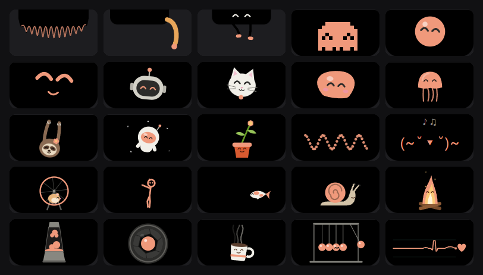
</div>

Девять опциональных питомцев Codex можно импортировать локально из установленного приложения Codex — их атласы
хранятся только в твоём профиле.

## Погода и города

Погода сейчас на фоне подходящего неба, прогноз по часам и на 7 дней вперёд, плюс карточки ветра, влажности,
давления, солнца, осадков и УФ-индекса. До 8 сохранённых городов с переключением в один клик, точные IANA
часовые пояса и автоматический резерв (MET Norway + Open-Meteo) без API-ключей.

<div align="center">
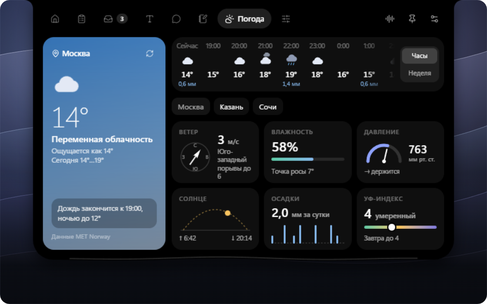
</div>

## Что внутри

<table>
<tr>
<td width="50%" valign="top">
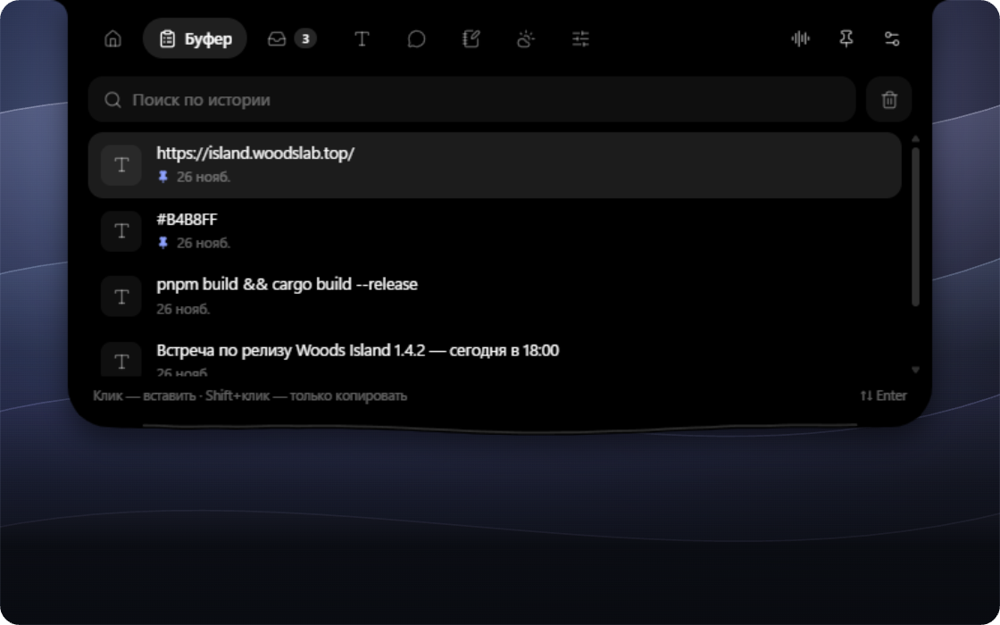
<b>Буфер обмена.</b> История текста, изображений и файлов с поиском и закреплением в локальном SQLite. Клик вставляет запись в активное окно; текст можно превратить в QR-код.
</td>
<td width="50%" valign="top">
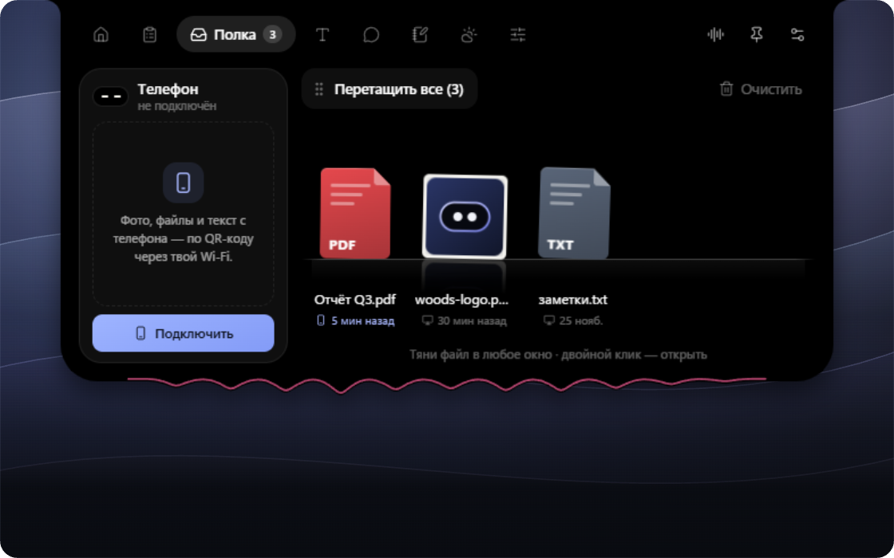
<b>Полка и телефон по QR.</b> Бросай файлы на остров или отправляй фото, видео и текст с iPhone/Android по QR через домашний Wi-Fi без облака и установки приложений. Сессия сохраняется между перезапусками.
</td>
</tr>
<tr>
<td valign="top">
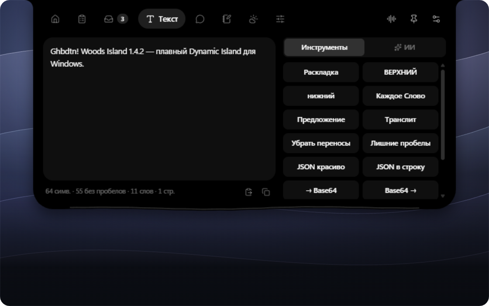
<b>Текст.</b> Исправление раскладки, регистр, транслитерация, JSON, Base64, URL, стилизованные QR-коды (6 стилей) и действия ИИ: перевод, правка, сокращение, объяснение, ответ.
</td>
<td valign="top">
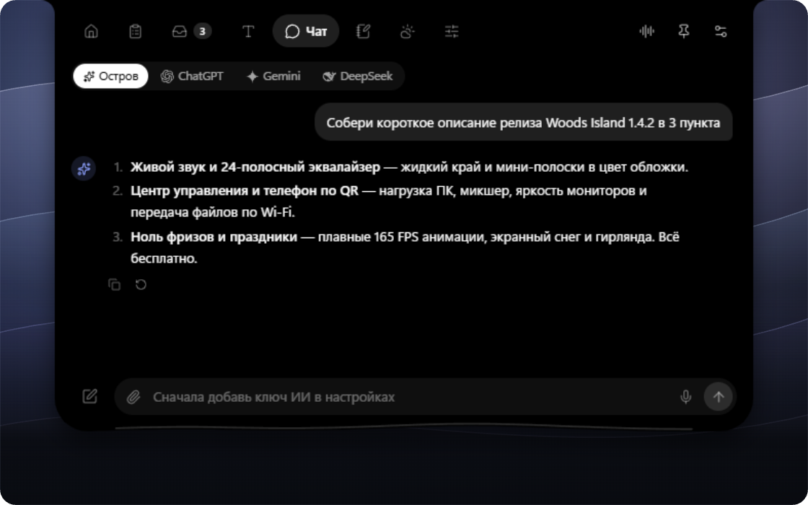
<b>Чат и Web AI.</b> Диалог с ИИ с вложением картинок и документов (PDF, Word, Excel, PowerPoint), диктовка голосом, свой API-ключ / Ollama или встроенные ChatGPT, Gemini и DeepSeek в пилюле и отдельном окне.
</td>
</tr>
<tr>
<td valign="top">
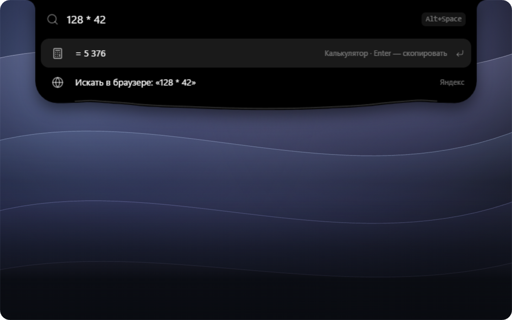
<b>Командная строка.</b> Программы, файлы, калькулятор, конвертер величин и валют, веб-поиск, таймеры («таймер 25 мин Отчёт»), напоминания, управление системой и команды cmd/PowerShell через <code>&gt;</code>. <code>Alt+Space</code>.
</td>
<td valign="top">

<b>Заметка, таймер и напоминания.</b> Автосохраняемые заметки с форматированием, чек-листами, папками и экспортом в Obsidian, плюс таймер с подписью и напоминания одной фразой.
</td>
</tr>
<tr>
<td valign="top">
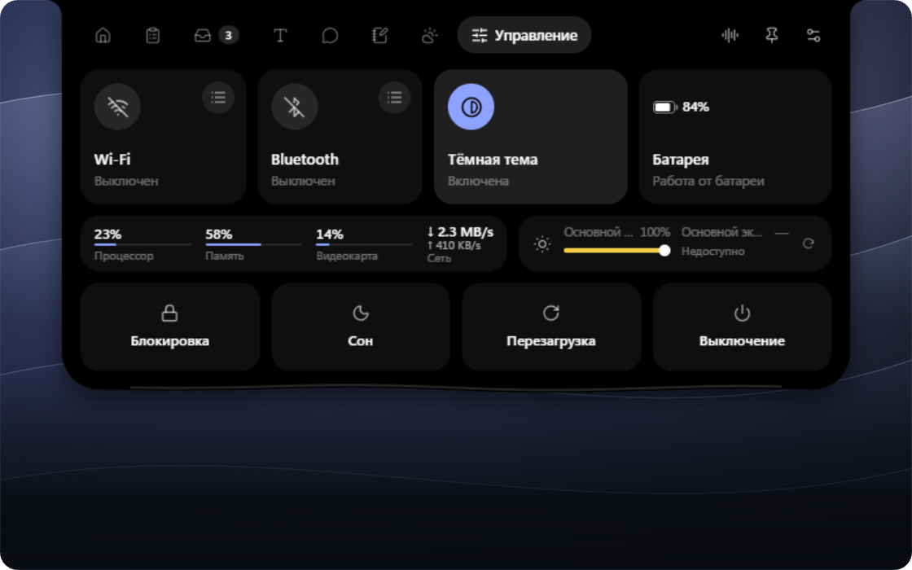
<b>Центр управления.</b> Wi-Fi, Bluetooth, Ethernet, тёмная тема, VPN, живая нагрузка CPU/GPU/RAM/сети, микшер приложений и яркость каждого поддерживаемого монитора (DDC/CI).
</td>
<td valign="top">
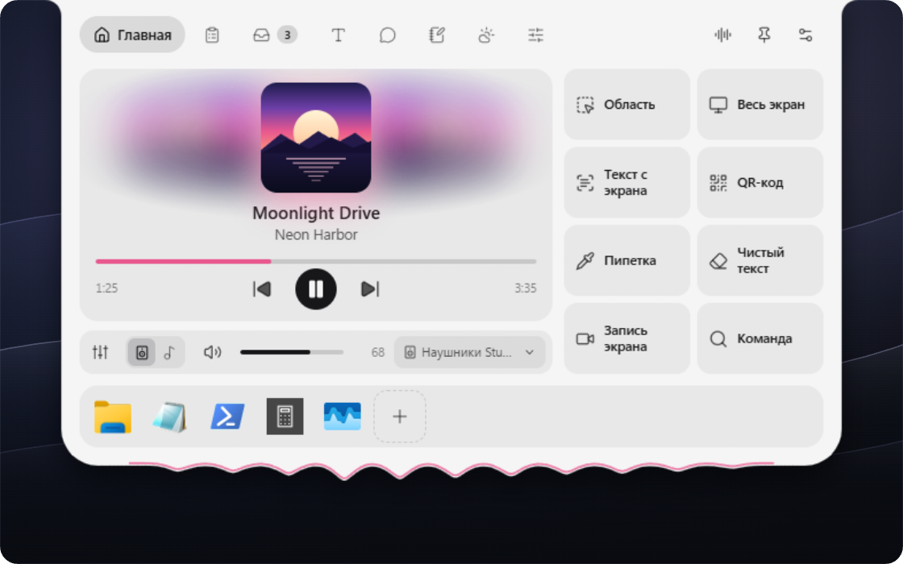
<b>Темы, масштаб и праздники.</b> Тёмная, светлая или системная тема, любой цвет пилюли, масштаб 80–200%, снежная шапка, гирлянда по контуру в такт музыке и падающий снег поверх всего экрана.
</td>
</tr>
</table>

## Что нового в 1.4.2

- **Плавность 165 FPS без фризов:** убраны GPU-фризы Skia Graphite (Dawn D3D12) на первом открытии и переключениях вкладок, синхронные IPC переведены в фоновый пул, убран лишний ресайз окна при открытии/закрытии, гирлянда залочена на контур пилюли без отставания.
- **24-полосный эквалайзер 30 Гц с адаптивным AGC:** живая жидкая волна и 4-зонный мини-эквалайзер в цвет обложки с чистым затуханием в тишине; улучшен поиск синхронизированных текстов песен (LRCLIB fallback).
- **Центр управления и устройства:** адаптивные карточки, микшер приложений, яркость мониторов (DDC/CI), нагрузка CPU/GPU/RAM/сети по требованию, подписи таймеров и компактный заряд периферии ([подробности](docs/peripheral-support.md)).
- **Телефон по QR, полка и экранный снег:** обновлённый интерфейс телефона, статус сети и подтверждения, карточки и превью файлов на полке, исправленный полноэкранный снег и прозрачность кликов в зоне свечения.
- **Полный список изменений:** [RELEASE_NOTES_1.4.2.md](RELEASE_NOTES_1.4.2.md).

## Установка

Скачай **Woods-Island-1.4.2-windows-x64-Setup.exe** из
[релиза v1.4.2](https://github.com/nimalekyt-bit/woods-island/releases/tag/v1.4.2) (**Windows 10/11 x64**).
FFmpeg для записи MP4/GIF уже в комплекте; автообновления проверяют цифровую подпись. Перед запуском можно сверить
SHA256 с **SHA256SUMS.txt**. Также доступен портативный архив **Woods-Island-1.4.2-windows-x64-portable.zip**.

### Горячие клавиши

| Действие | Сочетание |
|---|---|
| Открыть / закрыть остров | `Ctrl+Alt+I` |
| Командная строка | `Alt+Space` |
| Чат с ИИ | `Ctrl+Alt+A` |
| Буфер обмена | `Ctrl+Alt+V` |
| Скриншот области / экрана | `Ctrl+Alt+S` / `Ctrl+Alt+Shift+S` |
| Текст с экрана (OCR) | `Ctrl+Alt+O` |
| Запись экрана | `Ctrl+Alt+R` |

### Приватность и локальное хранение

Настройки, SQLite буфера, полка и заметки хранятся локально в `%APPDATA%\woods-island`. Ключи ИИ и токен сессии
телефона шифруются Windows DPAPI. Передача с телефона работает строго внутри локальной Wi-Fi сети без облаков.

</details>

<details>
<summary><b>English</b> · click to read in English</summary>
<br>

<div align="center">

A liquid black pill at the top of your screen that shows what is happening right now<br>
and expands into a complete toolbox on click. 100% free.

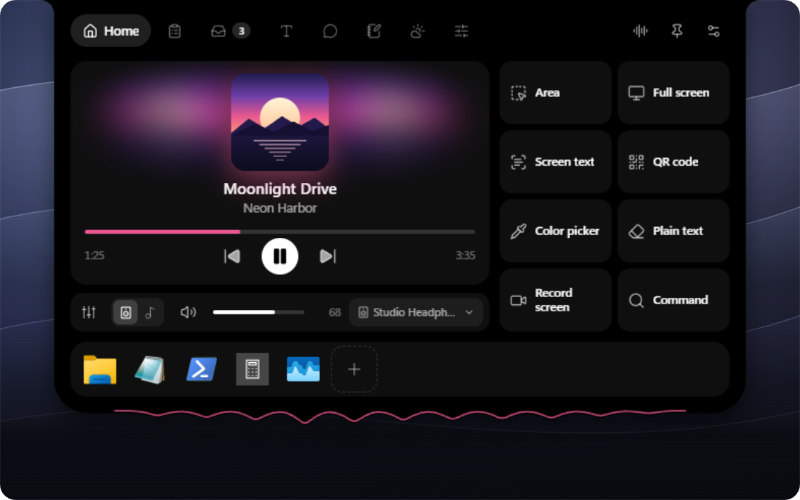

</div>

## What it is

Woods Island lives above every window at the top center of your Windows desktop. Collapsed, it stays compact
with your music, weather, timer, PC load, microphone/camera indicators, downloads and notifications. Click it
(or reach the top edge) and it expands smoothly into clipboard history, a file shelf with Wi-Fi QR phone
transfer, text tools, AI chat, notes, weather, a control centre and a command bar.

It never steals keyboard focus from the window you are typing in, so clicking a clipboard entry pastes directly
where your caret is.

<div align="center">
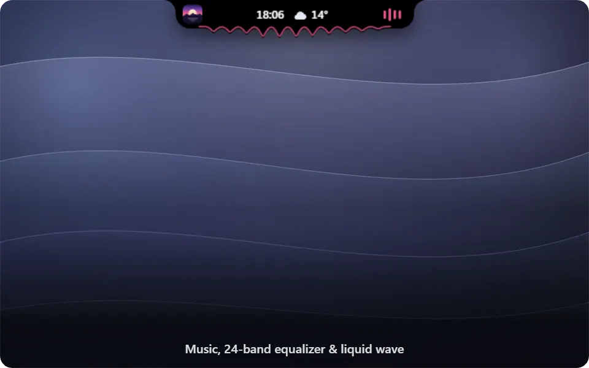
</div>

## The pill is alive

Its liquid bottom edge reaches toward your cursor and reacts to real audio with a 24-band 30 Hz AGC equalizer
tinted to the album cover (via WASAPI Loopback, including per-app capture), settling cleanly to zero in silence.

<div align="center">
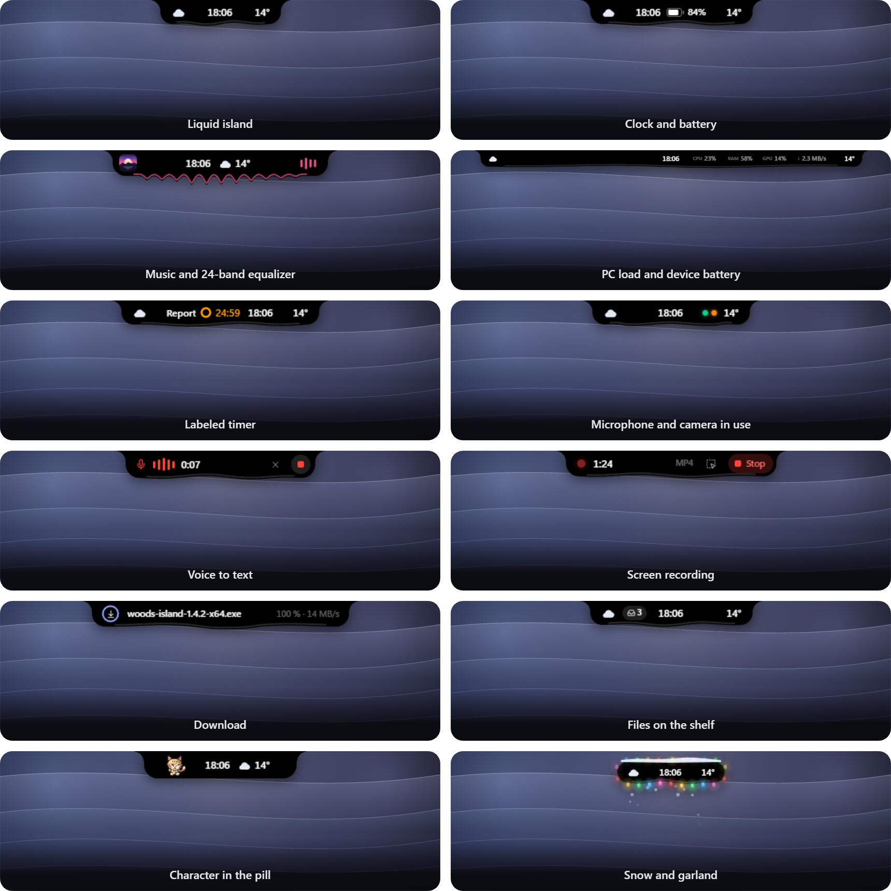
</div>

Live event cards appear on their own and fold away cleanly:

<div align="center">
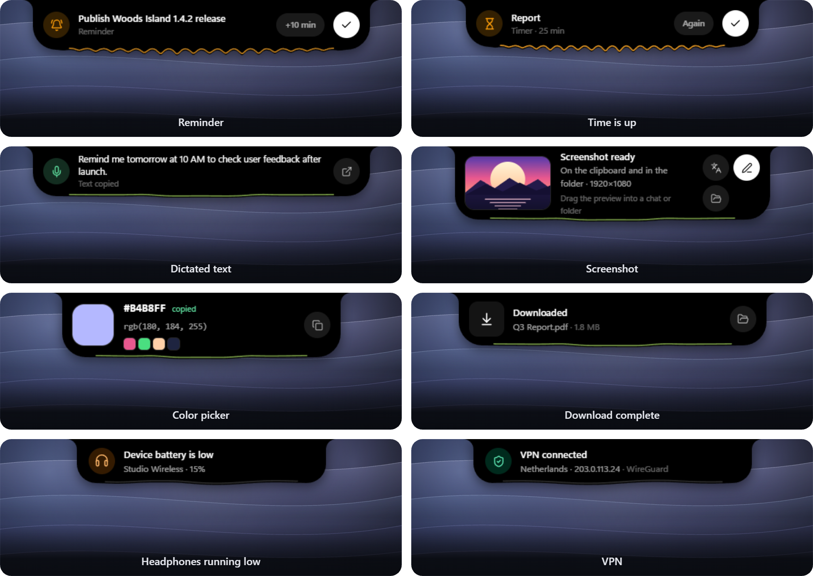
</div>

Music with synced lyrics · voice dictation · labeled timers and reminders · browser, torrent & Steam downloads ·
mic/camera dots with one-click mute · mouse-wheel volume · keyboard layout & Caps Lock · peripheral battery
levels (DAREU A950 Air V3, manual Logitech G435 LIGHTSPEED, and more) · CPU/GPU/RAM/network load · Windows
notifications · VPN country/IP · screen recording & OBS · AI agent hooks (Claude Code, Codex, OpenCode).

Need it out of the way of browser tabs? Use **Auto-hide**, **per-app hiding**, or **Notch Bar mode** (AppBar)
so maximized windows start cleanly below the island.

<div align="center">
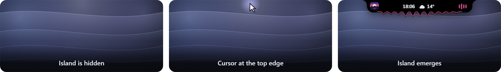
</div>

## 41 built-in characters + 9 optional Codex pets

Liquid island is the default, and **Settings → Character** offers **41 built-in characters** with live
previews: Pixel, Tail, Legs, Jellyfish, Campfire, Hamster, 5 seasonal characters (Snowman, Frost, Bullfinch,
Gingerbread, Reindeer) and **11 original Woods pixel pets** — all completely free without subscriptions.

<div align="center">

</div>

Nine optional Codex pets can be imported locally from an installed Codex app; their atlases stay strictly in
your local profile.

## Weather & Cities

Current sky and conditions, 24-hour and 7-day forecasts, plus wind, humidity, pressure, sun arc, precipitation
and UV tiles. Switch up to 8 saved cities in one click with IANA timezones and automatic MET Norway +
Open-Meteo fallback — zero API keys required.

<div align="center">

</div>

## Inside

<table>
<tr>
<td width="50%" valign="top">
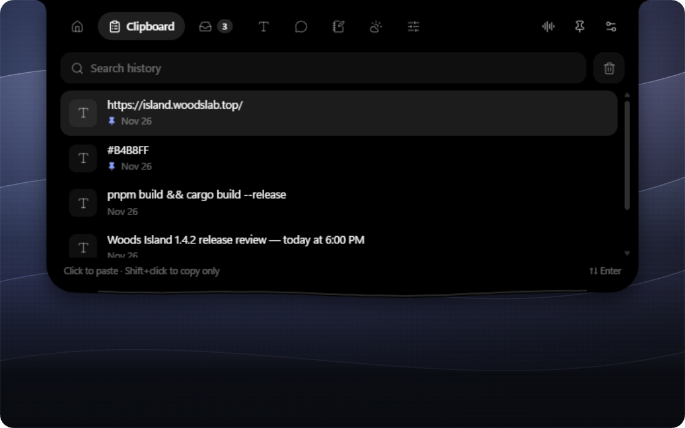
<b>Clipboard.</b> Local SQLite history of text, images and files with search, pins, one-click paste and instant QR generation.
</td>
<td width="50%" valign="top">
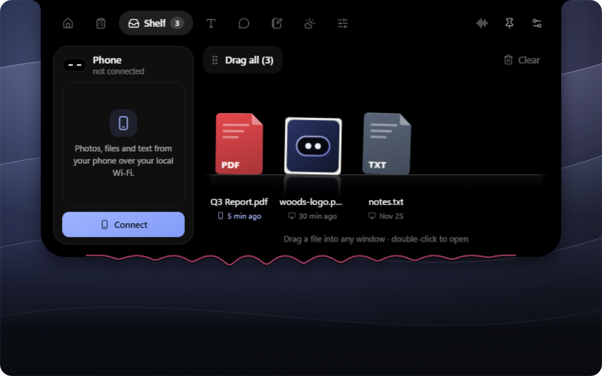
<b>Shelf &amp; phone via QR.</b> Drop files on the island or send photos, videos and text from iPhone/Android over local Wi-Fi via QR — no cloud, no mobile app, persistent reconnect across restarts.
</td>
</tr>
<tr>
<td valign="top">
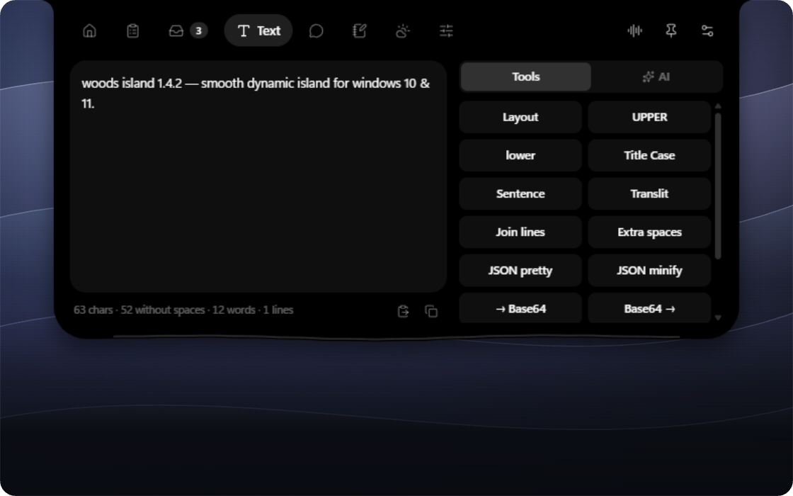
<b>Text.</b> Layout fix, case, transliteration, JSON, Base64, URLs, 6 styled QR presets and AI actions (translate, fix, shorten, explain, reply).
</td>
<td valign="top">
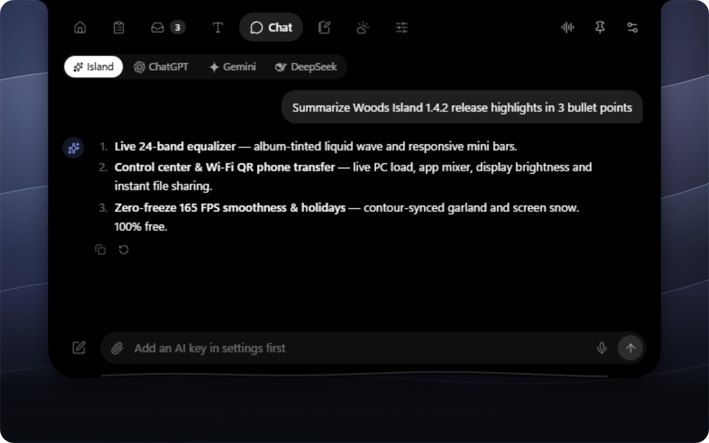
<b>AI Chat &amp; Web AI.</b> Context-aware AI chat with image/document attachments (PDF, Word, Excel, PowerPoint), voice input, your own API key / Ollama, or built-in ChatGPT, Gemini &amp; DeepSeek.
</td>
</tr>
<tr>
<td valign="top">
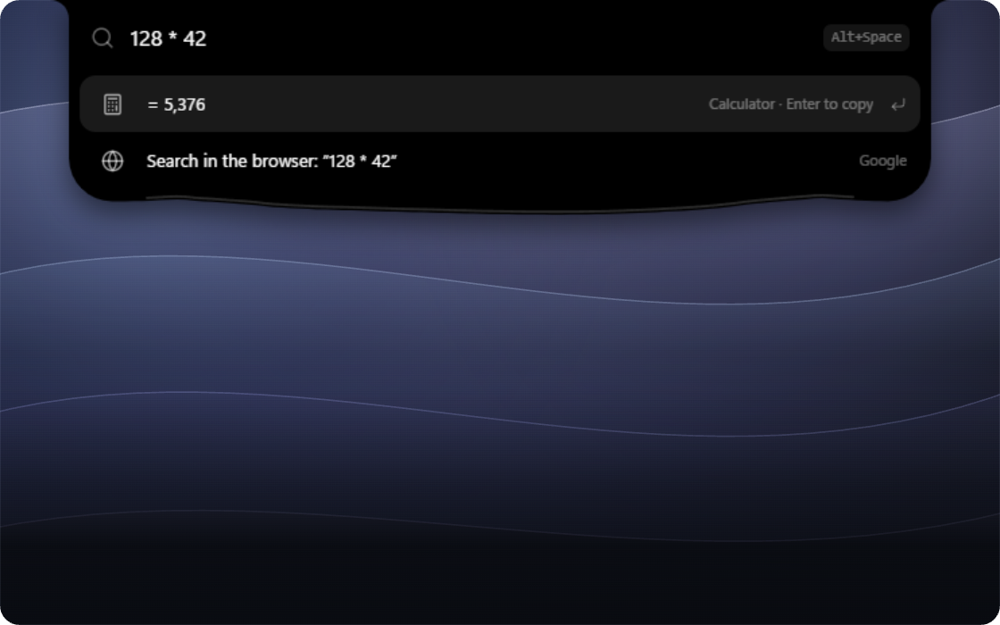
<b>Command bar.</b> Launch apps, search files, calculate, convert units &amp; currencies, start labeled timers, set reminders, control system toggles or run shell commands after <code>&gt;</code>. <code>Alt+Space</code>.
</td>
<td valign="top">
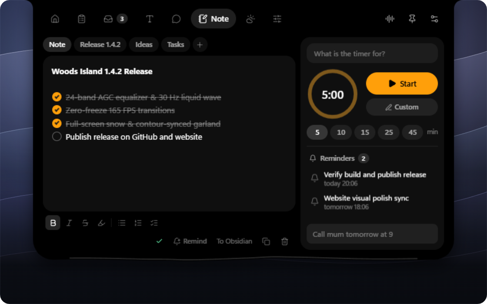
<b>Notes, timer &amp; reminders.</b> Auto-saving formatted notes with checklists, folders and Obsidian Markdown export alongside a labeled timer and natural-language reminders.
</td>
</tr>
<tr>
<td valign="top">
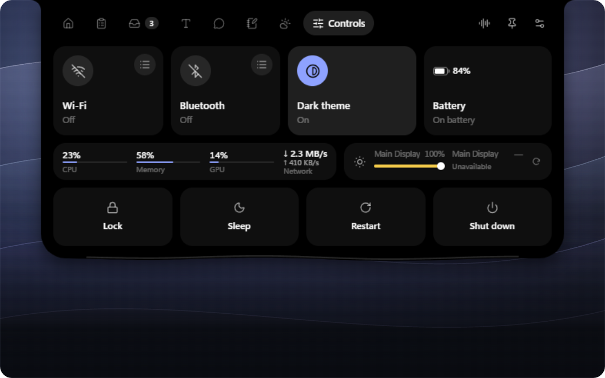
<b>Control center.</b> Wi-Fi, Bluetooth, Ethernet, dark mode, VPN, on-demand CPU/GPU/RAM/network load, per-app audio mixer and DDC/CI display brightness.
</td>
<td valign="top">
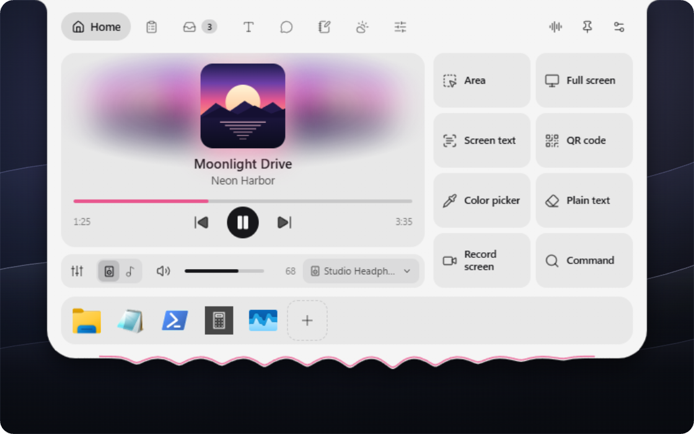
<b>Themes, scale &amp; holidays.</b> Dark, light or system theme, custom pill color, 80–200% scale, pill snow cap, contour-synced music garland and full-screen click-through snow.
</td>
</tr>
</table>

## What's new in 1.4.2

- **Zero-freeze 165 FPS smoothness:** eliminated WebView2 Skia Graphite shader-compile stalls on first open and tab switching, moved sync IPC commands off the UI thread, eliminated open/close window resize churn, and frame-locked holiday garland to the liquid contour.
- **24-band 30 Hz AGC equalizer:** responsive liquid wave and 4-zone mini equalizer tinted to album artwork with clean silence decay, plus improved LRCLIB synced lyrics fallback.
- **Control center & devices:** adaptive cards, per-app audio mixer, DDC/CI monitor brightness, demand-driven CPU/GPU/RAM/network readings, labeled timers and compact peripheral batteries ([details](docs/peripheral-support.md)).
- **Phone QR, shelf & full-screen snow:** refreshed phone panel with network/approval states, file preview cards on shelf, fixed full-screen snow overlay and click-through visual overscan.
- **Full release notes:** [RELEASE_NOTES_1.4.2.md](RELEASE_NOTES_1.4.2.md).

## Install

Download **Woods-Island-1.4.2-windows-x64-Setup.exe** from
[release v1.4.2](https://github.com/nimalekyt-bit/woods-island/releases/tag/v1.4.2) (**Windows 10/11 x64**).
FFmpeg is bundled for MP4/GIF capture and signed auto-updates are built in. Verify SHA256 against
**SHA256SUMS.txt**, or use **Woods-Island-1.4.2-windows-x64-portable.zip**.

Settings, SQLite history and notes stay local in `%APPDATA%\woods-island`; API keys and phone session tokens
are protected with Windows DPAPI.

</details>

---

## Разработка / Development

Windows 10/11 x64 · Node.js 22 · pnpm 10.33.0 · Rust 1.98.1 · Visual Studio Build Tools (C++).

```powershell
pnpm install --frozen-lockfile
pnpm build
cargo +1.98.1 build --release --locked --manifest-path src-tauri/Cargo.toml --bin woods-island
```

## Проект и сайт

Автор: Никита Кузнецов / Woods.
Лицензия и компоненты: [LICENSE](LICENSE) · [THIRD_PARTY_NOTICES.md](THIRD_PARTY_NOTICES.md).
Официальный сайт: [island.woodslab.top](https://island.woodslab.top/).

<div align="center">
<br>
<b>Woods Personal Corp</b><br>
Никита Кузнецов · <a href="https://t.me/woodskilla">@woodskilla</a> · <a href="https://github.com/nimalekyt-bit">GitHub</a>
</div>
