<div align="center">


# Woods Island

**Dynamic Island для Windows · 100% бесплатно · Woods Personal Corp**

[](https://github.com/nimalekyt-bit/woods-island/releases)
[](https://github.com/nimalekyt-bit/woods-island/releases/tag/v1.4.0)


[**Скачать установщик 1.4.0**](https://github.com/nimalekyt-bit/woods-island/releases/tag/v1.4.0) · [**Что нового**](RELEASE_NOTES_1.4.0.md) · [**Сообщить об ошибке**](https://github.com/nimalekyt-bit/woods-island/issues/new/choose) · [**Telegram**](https://t.me/woodskilla)

[**Сайт Woods Island**](https://island.woodslab.top/) · [**Портфолио автора**](https://me.woodslab.top/) · [**Woods Lab**](https://woodslab.top/) · [**support@woodslab.top**](mailto:support@woodslab.top)

Telegram — основной канал обсуждения проектов; почта — для коротких обращений без больших вложений.

</div>

---

<details open>
<summary><b>Русский</b></summary>
<br>

Чёрная динамическая пилюля у верхнего края экрана. Показывает музыку, погоду, заряд устройств,
загрузки и работу ИИ-агентов, а по клику раскрывает полку с передачей с телефона, буфер обмена,
заметки, ИИ и экранные инструменты.

<div align="center">

</div>

## Что нового в 1.4.0

- **Передача с телефона по QR (Wi-Fi):** отправляй фото, видео, файлы (до 256 МБ) и текст с iPhone или Android прямо на полку и в буфер Windows без облака и установки приложений. Поддерживается сохранение сессии и автопереподключение после перезапуска Woods Island.
- **Режим выреза (Notch Bar):** опциональная верхняя полоса (AppBar) в стилях *Чёрная*, *Стекло* или *Обои*, чтобы развёрнутые окна начинались аккуратно под островом.
- **Праздники и экранный снег:** мягкая снежная шапка на пилюле, гирлянда в такт музыке и отдельное окно падающего снега поверх экрана без мерцания.
- **Пять сезонных персонажей Woods:** Снеговик, Дед Мороз, Снегирь, Пряник и Олень — теперь в Woods Island **41 встроенный персонаж** (+ 9 опциональных питомцев Codex).
- **Звук и плееры:** захват звука конкретного плеера (WASAPI Process Loopback), поддержка AIMP/Winamp, резолвер PWA/Firefox и скрытие ненужных источников.
- **Погода и города:** до 8 сохранённых городов с быстрым переключением, IANA часовыми поясами и автоматическим резервным источником (MET Norway + Open-Meteo).
- **Умные интеграции и надёжность:** ChatGPT во встроенном окне Web AI, сохранение хуков агентов (Claude Code / Codex / OpenCode), календарь и напоминания, системный трей и watchdog-автовосстановление.

## Пилюля живая

Музыка, обложка, текст песен и прогресс трека. Часы, таймер, микрофон, запись экрана,
загрузки браузеров/торрентов, OBS, Steam и работа ИИ-агентов. Край острова реагирует на реальный звук
через WASAPI (включая захват только активного плеера): низкие и высокие частоты, цвет обложки и движение жидкости.

GSMTC подключает обычные Windows-плееры, AIMP/Winamp работают напрямую, а Яндекс Музыка Mod — через
Woods-коннектор. Остров раскрывается по клику; размер меняется от **80 до 200%**, есть автоскрытие и
режим выреза сверху экрана. Область вокруг острова пропускает клики к окнам под ним.

## 41 встроенный персонаж + 9 питомцев Codex

Жидкий остров, Пиксель, Искра, Глазки, медуза, костёр, хомяк, **5 сезонных персонажей Woods**
(Снеговик, Дед Мороз, Снегирь, Пряник, Олень) и **11 авторских пиксельных питомцев Woods**:
Складень, Узелок, Лунный Нокт, Нуль, Парадокс, Искорка, Кряжик, Нокт, Латунчик, Шурш и Скол.
У каждого восемь анимаций, моргание и живая реакция на музыку, курсор и события.
Выбирай в **Настройки → Персонаж** — всё доступно бесплатно без ключей и подписок.

<div align="center">

</div>

Девять дополнительных питомцев Codex подключаются из установленного на этом ПК приложения
(**Импортировать из установленного Codex**). Их атласы хранятся только локально в профиле;
все 41 встроенных персонажей работают независимо от Codex.

## Погода и города

Сейчас, следующие 24 часа и прогноз на 7 дней: ветер, влажность, давление, осадки, точка росы и восход/закат.
Поддерживается до 8 сохранённых городов в один клик, точные IANA часовые пояса и автоматический резерв
(MET Norway с fallback на Open-Meteo), поэтому прогноз загружается стабильно без API-ключей.

<div align="center">
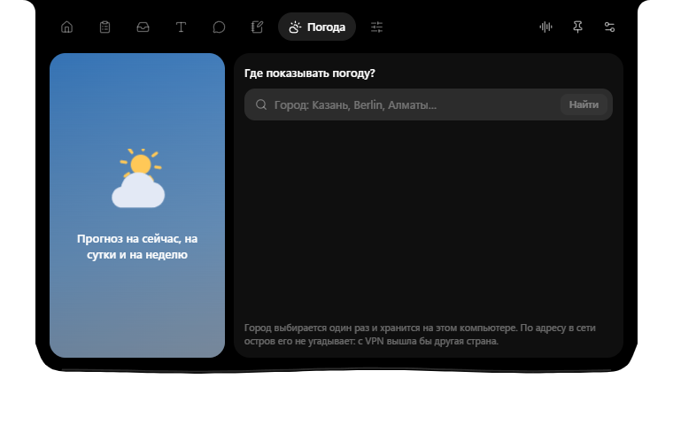
</div>

## Заряд устройств

На главной — строка периферии и подробная карточка. Для поддерживаемых моделей (включая DAREU A950 Air V3)
доступен автоматический заряд, имена, видимость и уведомления. Logitech G435 через LIGHTSPEED измеряется
вручную с предупреждением о паузе звука; FL680 отображается без процента.
[Поддерживаемые устройства и ограничения](docs/peripheral-support.md).

## Что внутри

<table>
<tr>
<td width="50%" valign="top">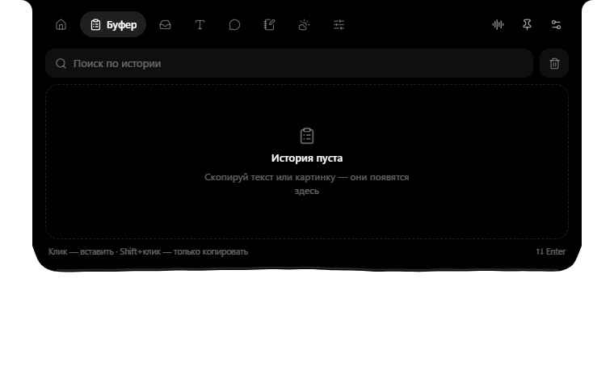<br><b>Буфер.</b> История текста, изображений и файлов, поиск и закрепление. Локальное хранение в SQLite.</td>
<td width="50%" valign="top">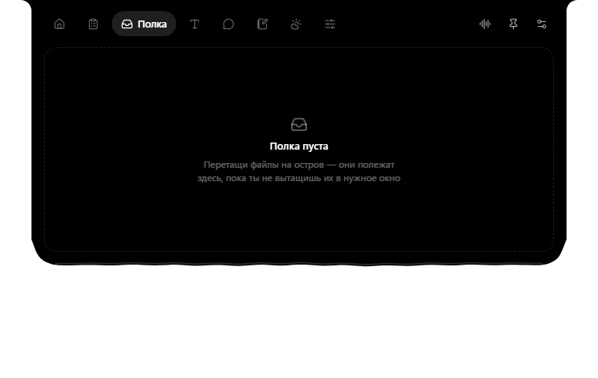<br><b>Полка и телефон.</b> Перетащи файлы на остров или отправь с телефона по QR через Wi-Fi. Превью и сохранность между перезапусками.</td>
</tr>
<tr>
<td valign="top">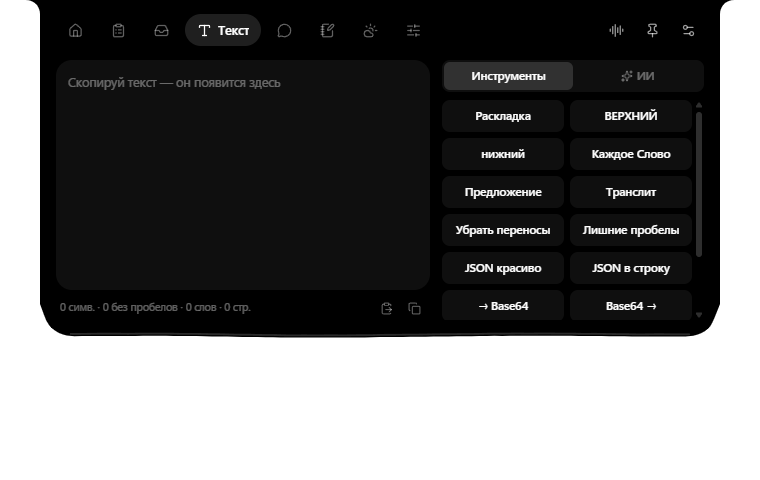<br><b>Текст.</b> Раскладка, регистр, транслитерация, JSON, Base64, URL, QR (6 стилей) и действия ИИ.</td>
<td valign="top">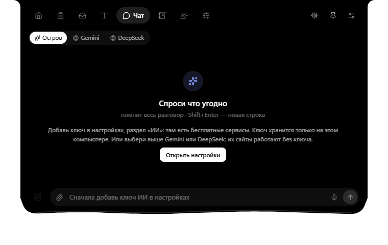<br><b>ИИ и Web AI.</b> Документы, изображения, потоковые ответы, свой API-ключ, локальная модель или встроенный ChatGPT.</td>
</tr>
<tr>
<td valign="top"><br><b>Заметки, календарь и Obsidian.</b> Форматирование, папки, таймер, напоминания и экспорт Markdown в выбранный vault.</td>
<td valign="top">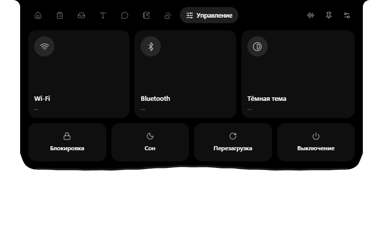<br><b>Управление.</b> Звук, микрофон, сеть, тема Windows, системный трей и быстрые действия.</td>
</tr>
</table>

### Рабочие инструменты

- Скриншоты области и экрана, редактор с разметкой и 6 стилями QR-кодов.
- Windows OCR, распознавание QR и пипетка цвета с историей.
- Запись MP4/GIF и системного звука через WASAPI/FFmpeg.
- Командная строка (`Alt+Space`), голосовой ввод, поиск, калькулятор, ярлыки и группы лаунчера.
- Статусы OBS, Steam, браузерных/торрент-загрузок и ИИ-агентов (Claude Code / Codex / OpenCode).
- Темы, прозрачность, мультимониторность, масштаб, автоскрытие, режим выреза и настройка всех хоткеев.

### Всё доступно без подписки Woods Island

Персонажи, телефон по QR, режим выреза, праздники, погода, OCR, запись и ИИ открыты полностью бесплатно.
Оплата внешнего ИИ зависит только от твоего провайдера.

## Установка

Скачай **Woods-Island-1.4.0-windows-x64-Setup.exe** из
[релиза v1.4.0](https://github.com/nimalekyt-bit/woods-island/releases/tag/v1.4.0),
пройди установку и запусти Woods Island через ярлык. Требуются **Windows 10/11 x64**.
FFmpeg для MP4/GIF входит в комплект. Если WebView2 Runtime отсутствует, установщик загрузит его у Microsoft.

Начиная с 1.2.0 установленное приложение проверяет и загружает обновления автоматически с проверкой цифровой подписи.
Установщик пока без EV-сертификата Windows, поэтому SmartScreen может показать предупреждение — перед запуском сверь
SHA256 с **SHA256SUMS.txt** в релизе.

Для запуска без установки доступен **Woods-Island-1.4.0-windows-x64-portable.zip**:
распакуй и запусти `woods-island.exe`, сохранив папку `bin` рядом.

### Горячие клавиши

Все сочетания меняются в настройках.

| Действие | Сочетание |
|---|---|
| Открыть / закрыть остров | `Ctrl+Alt+I` |
| Командная строка | `Alt+Space` |
| Чат с ИИ | `Ctrl+Alt+A` |
| Буфер обмена | `Ctrl+Alt+V` |
| Скриншот области / экрана | `Ctrl+Alt+S` / `Ctrl+Alt+Shift+S` |
| Текст с экрана (OCR) | `Ctrl+Alt+O` |
| Запись экрана | `Ctrl+Alt+R` |

### Приватность и локальное хранение

Настройки, SQLite, полка и заметки хранятся локально в `%APPDATA%\woods-island`.
Ключи и токен сессии телефона шифруются через Windows DPAPI. Локальная передача с телефона работает строго внутри твоей Wi-Fi сети без внешних серверов.

</details>

<details>
<summary><b>English</b> · click to read</summary>
<br>

A black dynamic pill at the top of your Windows screen. Live media, weather, device batteries,
downloads and AI agent statuses stay visible; a click expands the shelf with Wi-Fi phone transfer,
clipboard, notes, AI and screen tools — 100% free.

<div align="center">
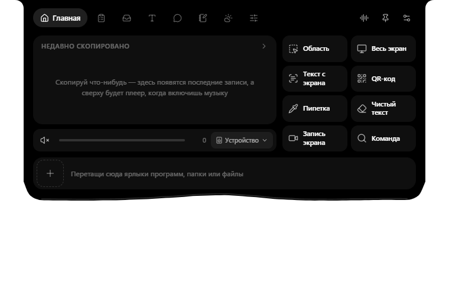
</div>

## What's new in 1.4.0

- **QR Phone Transfer over Wi-Fi:** send photos, videos, files (up to 256 MB) and clipboard text from iPhone/Android directly to the Windows shelf without any cloud or mobile app, with persistent session auto-reconnect across app restarts.
- **Notch Bar Mode (AppBar):** optional MacBook-style top strip (*Black*, *Glass*, or *Wallpaper*) so maximized windows start cleanly below the island.
- **Holidays & Screen Snow:** soft snow cap on the pill, music-reactive garland and an independent click-through full-screen snow layer.
- **Five Seasonal Woods Characters:** Snowman, Frost, Bullfinch, Gingerbread and Reindeer — **41 built-in characters** total (+ 9 optional local Codex pets).
- **Audio & Players:** per-app WASAPI Process Loopback, AIMP/Winamp support, PWA/Firefox name resolution and hidden media sources.
- **Multi-city Weather:** switch up to 8 saved cities with IANA timezones and automatic MET Norway + Open-Meteo resilience.
- **Integrations & Reliability:** built-in ChatGPT Web AI, persistent agent hooks (Claude Code / Codex / OpenCode), calendar reminders, system tray and watchdog self-recovery.

## A living island

The liquid edge responds to real WASAPI audio (including per-app loopback) and album artwork.
Windows players use GSMTC, AIMP/Winamp work natively, and Yandex Music Mod connects via the Woods connector.
Resize from **80 to 200%**, enable auto-hide or top Notch Bar, and pick from **41 built-in characters**,
all completely free without keys or subscriptions.

<div align="center">

</div>

Nine optional Codex pets can be imported locally from an installed Codex app; their atlases remain only
in your local profile and all 41 built-in characters work independently.

## Weather & Peripheral Batteries

Current conditions, 24-hour and 7-day forecasts for up to 8 saved cities with automatic MET Norway / Open-Meteo
fallback and IANA DST timezones. Peripheral telemetry supports automatic battery tracking (e.g., DAREU A950 Air V3),
manual LIGHTSPEED measurement for Logitech G435 and presence display for FL680 ([details](docs/peripheral-support.md)).

## Inside

<table>
<tr>
<td width="50%" valign="top">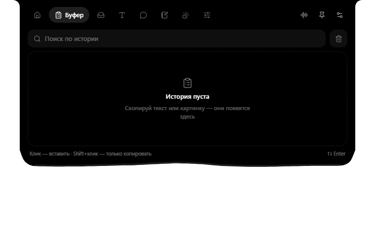<br><b>Clipboard.</b> Local SQLite history of text, images and files with search and pins.</td>
<td width="50%" valign="top">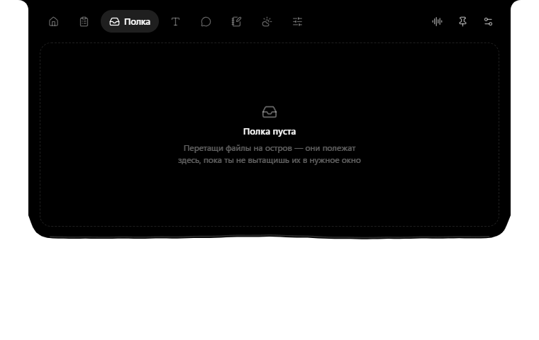<br><b>Shelf & Phone.</b> Drop files or transfer from your phone over local Wi-Fi via QR code.</td>
</tr>
<tr>
<td valign="top">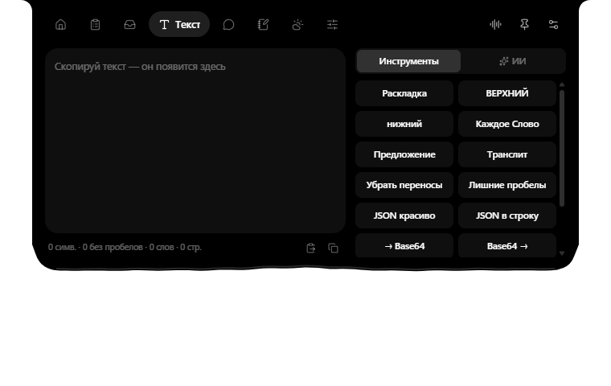<br><b>Text.</b> Layout, case, transliteration, JSON, Base64, URLs, styled QR codes and AI actions.</td>
<td valign="top">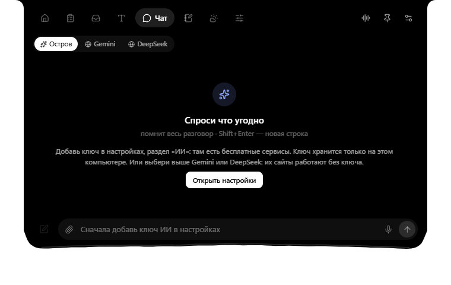<br><b>AI & Web AI.</b> Streaming chat with files/images, your own API key, local model or built-in ChatGPT.</td>
</tr>
<tr>
<td valign="top">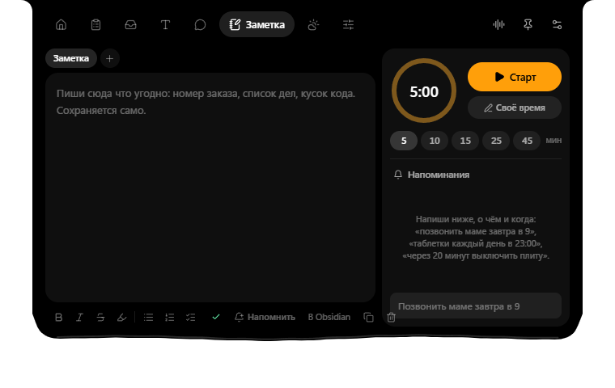<br><b>Notes, Calendar & Obsidian.</b> Formatting, folders, timers, reminders and explicit Markdown export.</td>
<td valign="top">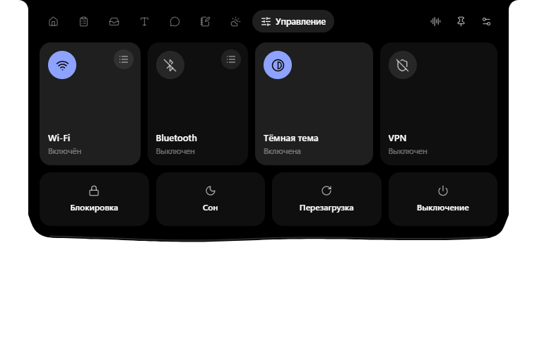<br><b>Controls.</b> Audio, microphone, network, Windows theme, system tray and quick actions.</td>
</tr>
</table>

## Install

Download **Woods-Island-1.4.0-windows-x64-Setup.exe** from
[release v1.4.0](https://github.com/nimalekyt-bit/woods-island/releases/tag/v1.4.0) (Windows 10/11 x64).
FFmpeg is bundled for MP4/GIF capture; built-in updates verify signatures automatically.
Compare SHA256 against **SHA256SUMS.txt** before running.
A standalone **Woods-Island-1.4.0-windows-x64-portable.zip** is also provided.

Settings, SQLite and notes live locally in `%APPDATA%\woods-island`; API keys and phone session tokens are
protected with Windows DPAPI.

</details>

---

## Разработка / Development

Windows 10/11 x64 · Node.js 22 · pnpm 10.33.0 · Rust 1.98.1 · Visual Studio Build Tools (C++).

```powershell
pnpm install --frozen-lockfile
pnpm build
cargo +1.98.1 build --release --locked --manifest-path src-tauri/Cargo.toml --bin woods-island
```

## Проект и сайт

Автор: Никита Кузнецов / Woods.
Лицензия и компоненты: [LICENSE](LICENSE) · [THIRD_PARTY_NOTICES.md](THIRD_PARTY_NOTICES.md).
Официальный сайт: [island.woodslab.top](https://island.woodslab.top/).

<div align="center">
<br>
<b>Woods Personal Corp</b><br>
Никита Кузнецов · <a href="https://t.me/woodskilla">@woodskilla</a> · <a href="https://github.com/nimalekyt-bit">GitHub</a>
</div>
